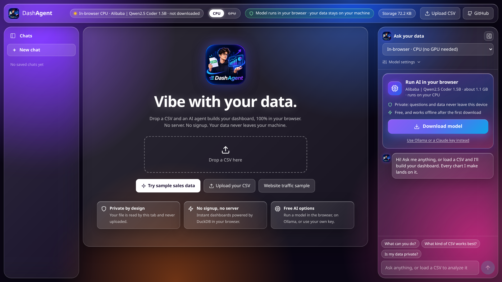
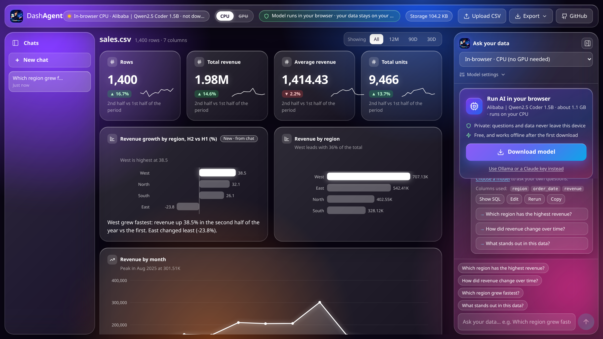
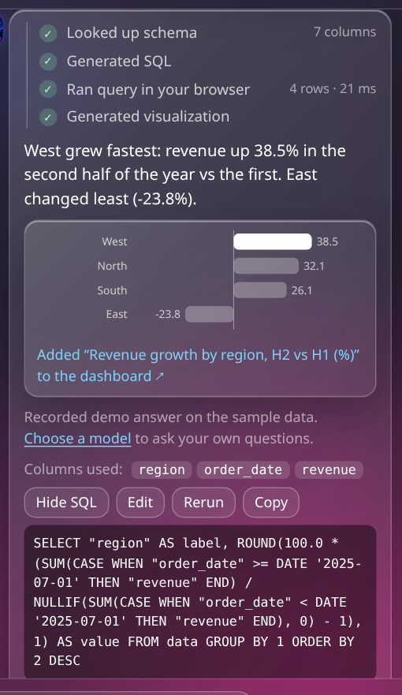
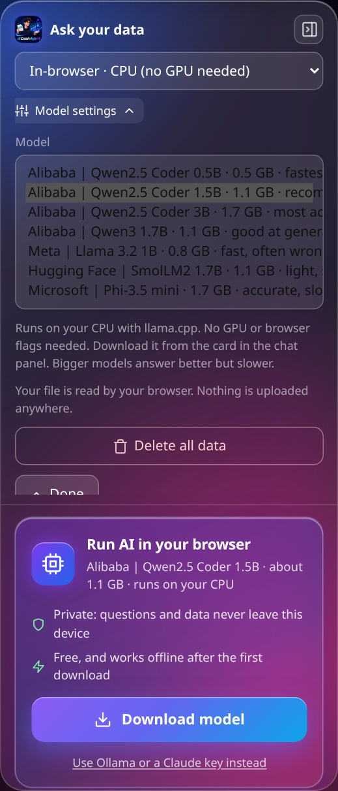
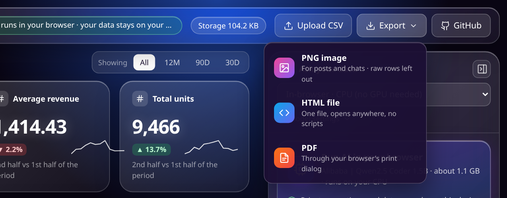
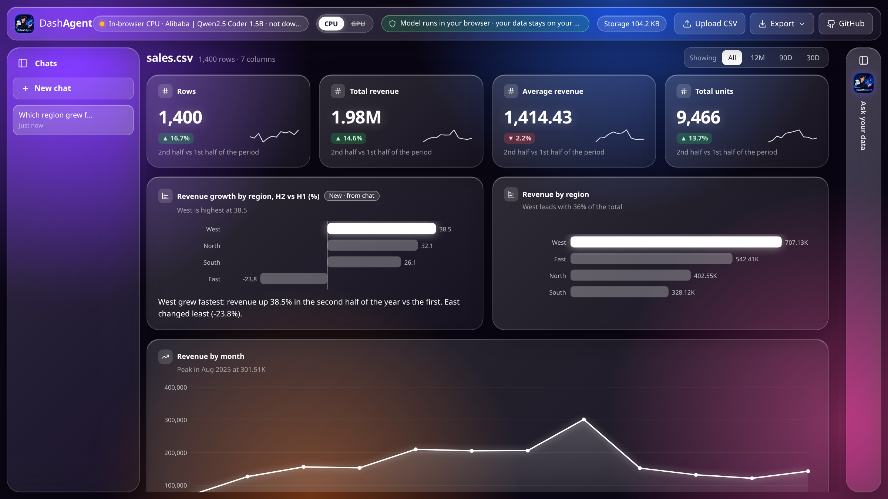
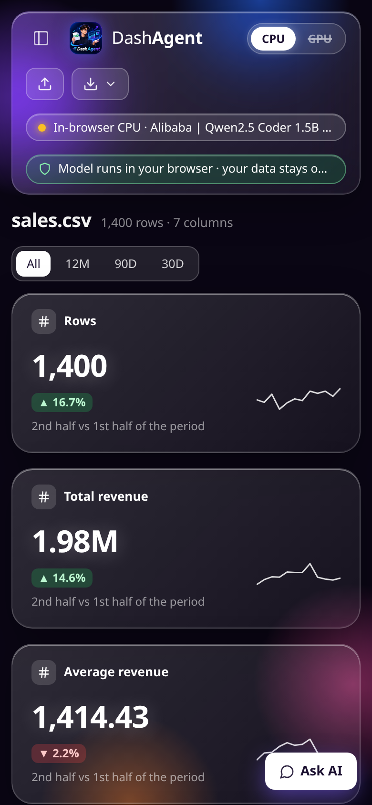
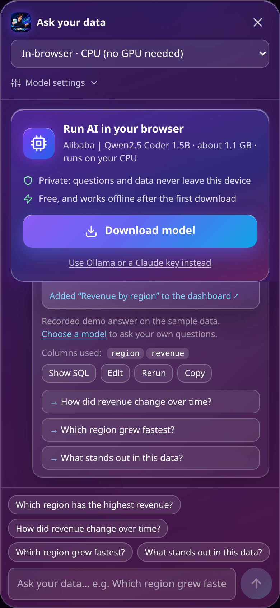

# DashAgent screenshots

What the app looks like. Everything here runs in the browser tab: no server, no signup.
Try it yourself on the [live demo](https://lokendra-builds.github.io/dashagent/).

## 20-second demo

## Start screen

Drop a CSV, upload one, or try a sample dataset. The CPU / GPU switch and the privacy badge sit in the header.

## Instant dashboard + chat

Load a CSV and the dashboard builds itself: KPI cards with sparklines, a monthly trend, breakdowns. Ask a question on the right; the chart lands on the dashboard.

## Every answer shows its work

The steps, the chart, the columns used, and the SQL, which you can edit and rerun.

## Pick your AI model

Seven small open models run on your CPU, no GPU needed: Alibaba Qwen, Meta Llama, Hugging Face SmolLM2 and Microsoft Phi.

## Export: PNG, HTML or PDF

## More room for the dashboard

Minimize the chat to a slim rail; the charts redraw to the new width.

## On your phone

  
  &nbsp;
  

